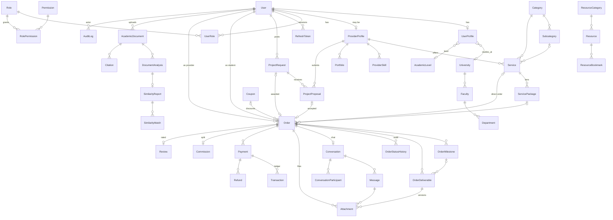

# UniHub — Database

- **Engine:** PostgreSQL (17 locally via `embedded-postgres`; any PostgreSQL 14+ in production)
- **ORM:** Prisma 6
- **Schema:** [`apps/api/prisma/schema.prisma`](../apps/api/prisma/schema.prisma)
- **Migrations:** [`apps/api/prisma/migrations/`](../apps/api/prisma/migrations/)
- **Seed:** [`apps/api/prisma/seed.ts`](../apps/api/prisma/seed.ts)

## Conventions

| Topic | Rule |
|---|---|
| IDs | `cuid()` strings. Human-facing numbers (`Order.number`, `SupportTicket.number`) are separate unique columns. |
| Timestamps | `createdAt` on every table. Mutable entities also have `updatedAt` (`@updatedAt`). |
| Money | `Decimal(12,2)` plus a `currency` column (default `JOD`). Never stored as float. |
| Rates | `Decimal(5,4)` (e.g. `0.1500` = 15%). The commission rate is **snapshotted on the order** at creation. |
| Bilingual content | Catalog content uses paired columns (`titleEn`/`titleAr`, `descriptionEn`/`descriptionAr`). User-generated content (requests, messages) is stored as typed. |
| Notifications | Store an i18n `titleKey` + `params`, so they render in the reader's language. |
| Files | Only metadata is stored (`Attachment`, `AcademicDocument`). Bytes live in the storage adapter under a random `storageKey`. |

## Deletion policies

| Relationship | Policy | Reason |
|---|---|---|
| User → profile, tokens, roles, notifications, favorites, documents | `Cascade` | Personal data goes with the account. |
| Order → student / provider | `Restrict` | Financial records must survive. Users are deactivated, not deleted, once they have orders. |
| Payment / Refund / Commission → order | `Restrict` | Accounting integrity. |
| Service → category | `Restrict` | A category with services can't be deleted; deactivate it instead. |
| Service → subcategory, Order → service/package/proposal | `SetNull` | History is kept if the catalog changes. |
| Order → milestones, deliverables, history, notes, conversation | `Cascade` | Owned children. |
| AuditLog → actor | `SetNull` | The audit trail outlives the actor. |

## Entity groups

1. **Identity & access:** `User`, `Role`, `Permission`, `UserRole`, `RolePermission`, `RefreshToken`, `UserProfile`
2. **Academic reference:** `University`, `Faculty`, `Department`, `AcademicLevel`
3. **Providers:** `ProviderProfile`, `ProviderSkill`, `Portfolio`
4. **Catalog:** `Category`, `Subcategory`, `Service`, `ServicePackage`
5. **Requests:** `ProjectRequest`, `ProjectProposal`
6. **Orders:** `Order`, `OrderMilestone`, `OrderDeliverable`, `OrderStatusHistory`, `OrderNote`
7. **Messaging & files:** `Conversation`, `ConversationParticipant`, `Message`, `Attachment`
8. **Money:** `Payment`, `Transaction`, `Commission`, `Refund`, `Coupon`
9. **Engagement:** `Review`, `Favorite`, `Notification`, `SupportTicket`, `SupportTicketMessage`
10. **Academic tools:** `AcademicDocument`, `DocumentAnalysis`, `SimilarityReport`, `SimilarityMatch`, `Citation`
11. **Library:** `ResourceCategory`, `Resource`, `ResourceBookmark`
12. **System:** `AuditLog`, `SystemSetting`

## ERD (core relationships)



## Notable constraints and indexes

- `ProjectProposal @@unique([requestId, providerId])`: a provider can submit only one proposal per request.
- `Order.requestId` and `Order.proposalId` are unique: a request is awarded at most once.
- `Review.orderId` is unique: one review per order, allowed only once the order is `COMPLETED` (enforced in the service).
- `ServicePackage @@unique([serviceId, tier])`: at most one Basic, one Standard and one Premium package.
- `Payment.gatewayRef` is unique, which makes webhooks idempotent.
- `RefreshToken.tokenHash` is unique. `family` is indexed so a whole family can be revoked when a token is reused.
- Composite indexes: `Order(studentId,status)`, `Order(providerUserId,status)`, `Service(categoryId,status)`, `Notification(userId,readAt)`, `Message(conversationId,createdAt)`, `AuditLog(entityType,entityId)`.

## Commands

```bash
npm run db:start                      # start local PostgreSQL (keep this terminal open)
npm run db:migrate                    # prisma migrate dev (create/apply migrations)
npm run db:seed                       # load development seed data
npm -w apps/api run prisma:deploy     # production: apply committed migrations only
npm -w apps/api run prisma:studio     # browse data
```

## Seed data policy

Seed data is **development data only**. It contains:
- the category tree and catalog from the PRD;
- universities in Jordan;
- clearly marked demo accounts (`*@demo.unihub.local`).

It is never loaded in production, because `seed.ts` refuses to run when `NODE_ENV=production`. Ratings and counters are not fabricated. They start at zero, and only demo orders created through the normal workflow change them.
